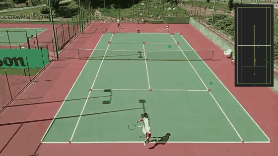
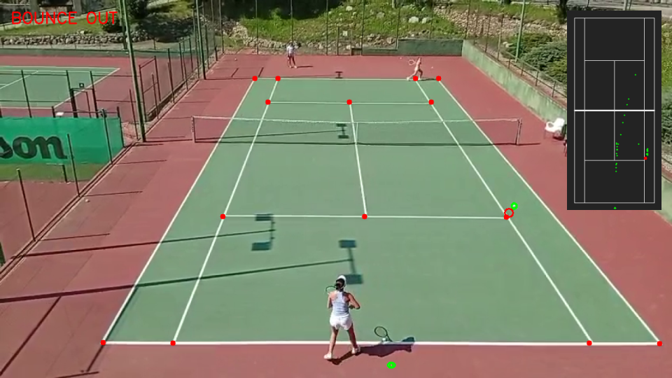

# CourtSight

Tennis match analysis from a single fixed camera: ball tracking, in/out line calls,
per-shot speed estimates, and hybrid-confirmed scoring — in the browser or from the CLI.



*Real output on a club court. Red dots are detected court keypoints, green is the ball
trail, and the panel on the right maps the rally in real court coordinates.*

---

## What it does

Upload a clip of a fixed-camera match and CourtSight will:

- **Track the ball** and detect **bounces** frame by frame
- **Map the court** to real-world metres via a homography, so a bounce becomes a point
  in metres rather than pixels
- **Call bounces in or out** against regulation ITF geometry, with a confidence that
  reflects how close to the line it landed
- **Estimate shot speeds** in km/h, always with an uncertainty band
- **Segment rallies** and propose who won each point, for a human to confirm or override
- **Keep score** — points, deuce, advantage, tiebreaks, sets, serve rotation

<p align="center">
  
</p>

## What it does *not* do

| Not supported | Why |
|---|---|
| Moving or broadcast multi-camera footage | Court detection assumes one fixed viewpoint |
| True 3D speed, net clearance | A single camera cannot recover depth — see below |
| Fully automatic scoring | Detecting *why* a rally ended is research-grade; a human confirms |
| Spin, shot classification, biomechanics | Out of scope for v1 |
| Clips longer than ~80 seconds | Every frame is held in RAM — see [Limits](#limits) |

## Accuracy and validation

The analysis modules refuse to state more than the data supports, and the UI carries
that through.

**Line calls** are reliable when the court is detected well, which it is on every clip
tested so far (100% of frames on all three). Confidence scales with distance from the
line: a bounce on the line reports ~0.5, not 1.0.

**Speeds are validated on clean footage only.** On a broadcast clip with the ball
tracked on 94% of frames, per-flight peaks come out at 138 / 137 / 143 km/h — textbook
professional rally speeds. On amateur clips with 49–67% tracking coverage, the same code
reports 213–259 km/h, which is *not* credible for club tennis.

The cause is geometric. Near the far baseline the homography's
metres-per-pixel is enormous — in one measured window the ball moved 13 pixels, which
mapped to **5.5 metres** of court distance. Sub-pixel jitter becomes tens of km/h, and
sparse tracking manufactures fake peaks. The fix is per-point uncertainty derived from
the homography Jacobian, so far-court measurements self-report as low confidence; it is
[written up in the decision log](docs/decisions.md) but not implemented. Thresholds have not
been tuned to mask the implausible values.

Until then the UI warns when ball tracking covers under 70% of frames, and every speed
is shown with its band.

**Rally outcomes are proposals**, capped at 0.6 confidence. The reasoning — "final
bounce landed out on player 1's side" — is shown so a human can judge it. Confirmations
and overrides are tracked, so `correction_rate` measures how good the automation
actually is, rather than trusting a confidence number the system invented about itself.

## Quick start

Requires Python 3.11 and an NVIDIA GPU for reasonable speed (CPU works, ~15× slower).
Full instructions including model weights are in **[SETUP.md](SETUP.md)**.

```powershell
# 1. environment
C:\Path\To\Python311\python.exe -m venv .venv
.venv\Scripts\python.exe -m pip install -r requirements.txt

# 2. CUDA build of torch, matched to your driver (see SETUP.md)
.venv\Scripts\python.exe -m pip install torch torchvision --index-url https://download.pytorch.org/whl/cu121

# 3. model weights -> data/weights/  (SETUP.md step 5)

# 4. the app
cd app/frontend && npm install && npm run build && cd ../..
.venv\Scripts\python.exe -m uvicorn app.backend.main:app --reload
```

Then open <http://127.0.0.1:8000>, upload a clip, and watch it process.

The CLI runs the same pipeline without the app:

```powershell
.venv\Scripts\python.exe scripts/run_perception.py     --input data/samples/<clip>.mp4
.venv\Scripts\python.exe scripts/render_debug_overlay.py --input data/samples/<clip>.mp4
.venv\Scripts\python.exe scripts/score_match.py        --input data/samples/<clip>.mp4
```

Any roughly-16:9 resolution is resized to 1280×720 automatically.

## How it works

```
video ─► court keypoints + homography ─┐
      └► ball pixel positions ─────────┼─► ball in court metres ─┬─► in/out calls
                                       │                          ├─► shot speeds
                                       └► bounce frames ──────────┴─► rallies ─► score
```

| Stage | Source |
|---|---|
| Court detection + homography | [yastrebksv/TennisCourtDetector](https://github.com/yastrebksv/TennisCourtDetector) |
| Ball tracking | [yastrebksv/TrackNet](https://github.com/yastrebksv/TrackNet) |
| Bounce detection (CatBoost) | [yastrebksv/TennisProject](https://github.com/yastrebksv/TennisProject) |
| In/out, speed, rallies, scoring | This repo |

The three pretrained models are treated as a **read-only vendored reference** under
`vendor/`; `src/perception/` wraps them behind a clean API and caches their output to
`data/processed/` as JSON, so inference runs **once per clip** and every downstream
stage is cheap to re-run.

### Layout

```
src/perception/   model wrappers + pixel↔metres homography   (needs GPU)
src/analysis/     in/out, speed, rally segmentation          (pure logic)
src/scoring/      court model + tennis state machine          (pure logic)
src/viz/          mini-court panel + annotated video
src/pipeline.py   orchestration and caching
app/backend/      FastAPI: upload → async job → results
app/frontend/     React UI
scripts/          CLI entrypoints
```

The deliberate split: everything under `src/analysis/` and `src/scoring/` is pure —
no GPU, no model weights, no disk — so the logic that decides a line call or a score is
exhaustively testable. `src/pipeline.py` is likewise split into an impure
`analyze_video()` and a pure `build_analysis()`.

## Limits

- **Clip length ~80 seconds by default.** Every decoded frame is held in RAM (2.64 MB
  per 1280×720 frame ⇒ ~4.6 GB per minute), because the vendored models take a frame
  *list*, not a stream. Longer clips are refused up front with an explanatory error
  rather than an OOM crash. Raise `COURTSIGHT_MAX_FRAMES` if you have the memory.
- **Jobs are in-memory** and lost on restart, a deliberate trade for a local tool rather than
  adding a task broker.
- **30 fps undersamples fast serves.** ≥60 fps footage from a fixed tripod materially
  improves both tracking density and speed accuracy.
- **A fixed camera is assumed.** Court detection runs on every 10th frame and the
  keypoints are consolidated to their median — 2.4× faster end-to-end, and it strips
  ~37 cm of per-frame homography jitter on amateur footage. Pass
  `court_sample_every=1, fixed_camera=False` for footage where the camera moves.
- **Serves are judged with rally rules.** Picking the right service box depends on the
  deuce/ad court, i.e. on the score — the wiring exists but is unvalidated against real
  serve footage, so it is not enabled.

## Development

```powershell
.venv\Scripts\python.exe -m pytest        # 205 tests, no GPU required
.venv\Scripts\python.exe -m ruff check .
```

Design decisions, including the ones later reversed, are logged in
[docs/decisions.md](docs/decisions.md). The phased plan is in
[docs/development-plan.md](docs/development-plan.md).

## Acknowledgements

Built on [yastrebksv](https://github.com/yastrebksv)'s TennisProject, TrackNet and
TennisCourtDetector. Mini-court visualisation approach borrowed in spirit from
[abdullahtarek/tennis_analysis](https://github.com/abdullahtarek/tennis_analysis).
